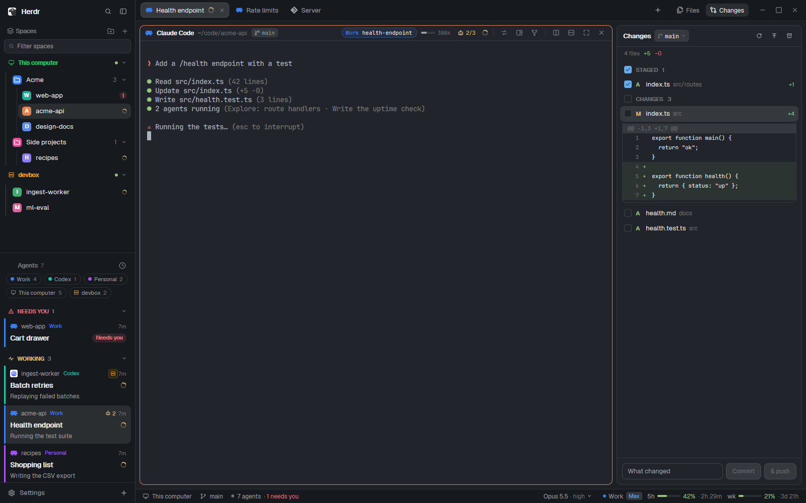

# Falconherd

A Herdr layout for working with coding agents, and the mods it's made of, each one usable on its own.

## The whole thing

This is Falconherd with every mod in place, as its author uses it every day:



Three accounts are set here, each with its color: Claude *Work* (blue), Claude *Personal* (purple)
and *Codex* (teal), on two machines: this computer (green) and *devbox* (amber).

- **Left, top: the sidebar** ([`falcon-sidebar`](falcon-sidebar/README.md)). Spaces by machine, in
  colored folders (*Acme*, *Side projects*): `web-app` has an agent that needs you (the red 1),
  `acme-api`, `recipes` and devbox's `ingest-worker` have agents at work (the spinners).
- **Left, bottom: the agents list** ([`falcon-agents`](falcon-agents/README.md)). Chips to filter
  by account or machine, whoever needs you first, then the ones at work: each card in its account's
  color, with its tab's name and what the agent is doing right now (Titles → With activity); the
  Codex one runs on devbox, and *Health endpoint* has two sub-agents running.
- **Top: the tab bar** ([`falcon-tabs`](falcon-tabs/README.md)). The space's tabs in their
  account's color with their state, the `+` launcher, and the Files and Changes panel buttons.
- **Middle: the pane header** ([`falcon-header`](falcon-header/README.md)) over the agent: its
  folder and branch, its account chip with the conversation's name, the context it has used, its
  sub-agents (2 of 3 running) and, on hover, fork, side chat, send a brief.
- **Right: the changes panel** ([`falcon-changes`](falcon-changes/README.md)), here with an inline
  diff open in its folder tree (a list is a click away), or the files panel ([`falcon-files`](falcon-files/README.md)) with its button.
- **Bottom: the status bar** ([`falcon-status`](falcon-status/README.md)): the focused agent's model
  and effort, its account and plan (*Work*, Max), and its 5-hour and weekly usage.

Add it all with the `falconherd` folder, or take only the parts you want.

## Add one

Copy this into the agent in Herdr, with the folder you want:

```text
Read ~/.config/herdr-app/AGENTS.md, then add this from https://github.com/HugoFMiranda/herdr-falconherd/tree/main/<folder>
```

The agent follows that folder's `RECIPE.md`: it copies the mods (and the layout, for `falconherd`),
merges the keys, checks each mod and, for the layout, switches to it. Adding one doesn't add the others.

## What's here

| Folder | What it is |
|---|---|
| [`falconherd`](falconherd/README.md) | **The whole layout**: everything below, placed together, with its keys |
| [`falcon-sidebar`](falcon-sidebar/README.md) | **Sidebar**: your machines, colored folders and spaces (repo and branch, agents working or needing you, worktrees), a filter, menus for each |
| [`falcon-agents`](falcon-agents/README.md) | **Agents list**: who needs you first, each card in its account's color with what it's doing, snooze, settle, pin, reopen closed conversations |
| [`falcon-tabs`](falcon-tabs/README.md) | **Tab bar**: tabs with their account's icon and state, drag, a tab menu with Regenerate title, the side panels' buttons, and the `+` launcher |
| [`falcon-header`](falcon-header/README.md) | **Pane header**: the conversation's account, folder, branch, context and sub-agents; fork, side chat, send a brief, continue on another account |
| [`falcon-files`](falcon-files/README.md) | **Files panel**: a tree with git colors and a filter, a Markdown reader, and copy to another connected machine |
| [`falcon-changes`](falcon-changes/README.md) | **Changes panel**: stage with checkboxes, a list or a folder tree, inline diffs, branches, fetch / pull / push / stash, commit |
| [`falcon-status`](falcon-status/README.md) | **Status bar**: the focused agent's model and effort (menus), its account and plan, 5-hour and weekly usage |
| [`helpers`](helpers/install.sh) | Optional small programs some features use (tab names, sub-agent pages, briefs, usage, Markdown rendering): `helpers/install.sh` links them into `~/.local/bin` |

Each folder has a `README.md` for people, a `RECIPE.md` for the agent that installs it (and for
building it again from scratch), and a `preview.png`. A mod folder's `mods/` also holds the small
mods it opens (the `+` popover, the Accounts window, the Markdown window); they aren't placed anywhere.

## Accounts

Claude Code and Codex accounts (which config folder each uses, its color and icon) are set in the
Accounts window, which also has the `+` menu's entries and the Titles settings. With no accounts set,
there's one Claude account (`~/.claude`) and Codex.

macOS and Linux first: on Windows the mods work, and the helpers need setting up by hand.
