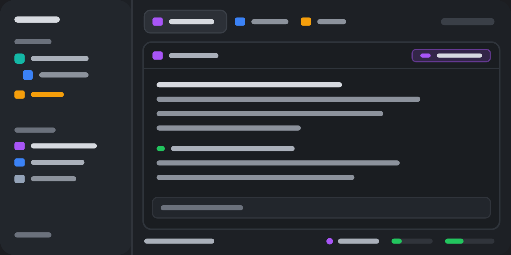

# Falconherd

A full window for working with coding agents. On the left, your machines with their folders and
spaces, and under them every agent sorted by whether it needs you. On top, tabs that wear each
account's color and say what they're doing. Each pane has a header with its account, folder, branch,
context and a toolbar (fork, side chat, send a brief). On the right, a files tree and a git changes
panel. At the bottom, a status bar with the agent's model, effort, usage limits and machine.

## What you see

Left to right: a 268px sidebar, then the work column.

- **Sidebar** (`#chrome` background, resizable, folds to a 44px rail):
  - **Top bar** (46px, drags the window): Herdr's logo and name, a search button (the space picker)
    and a fold button.
  - **Spaces** (half the remaining height): a "Spaces" header with New folder and New space
    buttons, a filter field, then each machine. "This computer" first, then every other machine in
    its color. A machine's folders and spaces sit beside a faint 1px line in that color. A machine
    header has a monitor or server icon, its name, a green dot when connected or its state word
    (connecting, asleep, disconnected), and a chevron to fold it. Its New folder and New space icon
    buttons (22px) show on hover. A folded machine shows one line: "3 spaces · 2 working · 1 needs
    you".
    - **Folders:** a colored tile with a folder icon, the name, the count, a + on hover, a chevron.
      An open folder's spaces hang from a guide line under the tile.
    - **Space rows** (30px): an 18px avatar with the first letter, in the space's color; the name;
      on the right, dimmed, the repo line `repo · branch ↑2 ↓1`; then a spinner while its agents
      work, and a red count of agents that need you. Worktrees sit under their checkout, indented,
      with a branch icon instead of the avatar. The shown space has the selected background.
    - A machine with no spaces says "No spaces".
  - **Agents** (the other half): an "Agents N" header with a sort menu (by what needs you, or by space), filter chips (one
    per account and machine), then sections: Needs you, Done, Working, Idle, Snoozed, Settled, Recently
    closed (the last three folded at first). Each agent is a card with a 3px edge in its account's color, the account glyph and name,
    the tab's name, optionally a line for what's happening (see Titles), the folder, how long it's been in its
    state, and its running sub-agents under it.
  - **Footer** (41px): Settings (a dot when an update is ready) and Add machine. On the rail, both
    stack (69px).
- **Tabs** (42px): one per tab: the account glyph tinted in its color (or the program's icon), the
  name, and its state on the right: a spinner (working), a red dot (needs you), a check (done).
  Then "N away" (settled tabs), + (the launcher), the side panels' buttons (Files, Changes,
  Insights when installed) and the window buttons.
- **Panes**: 8px gaps, 10px radius, a 1px border; the focused pane's border takes the shown space's
  color. Each pane has a 30px header (falcon-hood): account glyph and label chip, conversation name,
  the folder as `~/…`, the branch, where it came from ("fork of x", "side chat of y"), the machine
  badge, a session chip (click: copy), the context meter, sub-agents, and its state. On hover or
  focus a toolbar: Send to main, Continue on…, Side chat, Fork, split right and down, zoom, close.
- **Side panel** (368px, a stack): **Files**: a filter field, the folder's tree with git colors
  (green new, orange changed, red deleted), a Markdown reader that follows the open file, and a row
  menu (Copy path, Send to another machine). **Changes**: the branch with ↑/↓, fetch, pull, push,
  stash; Staged and Changes lists with a checkbox per file and inline diffs; Discard (asked first);
  a message box with Commit and Commit & push.
- **Status bar** (28px): the machine, the agents count, and for the focused agent its model and
  effort (menus), its account with plan, and the 5-hour and week usage bars with their reset times.

## How it behaves

- **Agent states**: working shows a spinner (tabs, space rows, cards); blocked (needs you) a red dot
  or count and the Needs you section; done a check; idle nothing. A folded folder with an agent that
  needs you shows a red dot.
- **Sidebar**: click a space to show it. Drag a space onto a folder to put it there, onto another
  space to move it there (and into that space's folder), onto "Drop here" to take it out. Right-
  click a space: colors, Color: automatic, Rename, worktrees (new, open, remove), Close. Right-click
  a folder: color, New space here, Edit folder…, Move up/down, Delete (asked). Right-click a
  machine (this computer too): New space, New folder…, its color; another machine also has a
  Connection page: Reconnect now, Disconnect / Connect, Update hc there, Forget (asked). Folders can
  collect spaces by where they work ("my-project, ~/code/client-*") and start new spaces in a folder.
  `alt-up` / `alt-down` go through the spaces as shown.
- **Folders** live in `~/.config/falconherd-folders.json` on each machine, so every screen showing a
  machine's spaces shows the same folders.
- **Tabs**: drag to reorder, middle-click closes, the wheel steps through tabs. Right-click: Rename,
  Regenerate title (Claude Haiku names it from the conversation now), New tab, Close.
- **Titles** (Accounts window → Titles; Herdr's way by default): tab names Herdr's or Claude Haiku's
  (a tab is named from its conversation at 3 messages and again at 10, while it keeps that name; a
  typed name is never replaced); agent cards with the tab's name only (Herdr's), or with a line under
  it for what's happening: while the agent works, what it says it's doing (its OSC 7501 `msg`); between
  replies, Claude Code's own name for the conversation or Claude Haiku's title for what it's doing now
  (asked again after each reply, at most once a minute).
- **Sub-agents** under an agent's card start folded; its bot count opens them.
- **Agents list**: click a card to show its pane; snooze (30 minutes, 1 hour, 3 hours, tomorrow 9:00, or until woken) settles
  its tab until then; a settled tab you look at goes back when you look elsewhere; Recently closed
  reopens a conversation. After a restart, conversations whose terminals came back as shells are
  resumed.
- **Pane header**: `ctrl-shift-d` forks the conversation into a new tab, `ctrl-shift-s` opens a side
  chat, `ctrl-shift-m` asks the side chat for a brief and sends it to its main conversation.
- **Files**: Send to copies a file or folder to another connected machine (tar through hc), asking
  where and before replacing.
- **Accounts**: the Accounts window (status bar account menu → Accounts; the + menu's Edit this menu)
  sets each account's tool, config folder, color, icon and command, and the + menu's own entries,
  order and hidden agents. Changes save as they're made.

## Built from

- **Layout tree**: `root` row → `sidebar` column (268px, min 44) [`brand` 46px falcon-roost
  `part: top` (window_drag), `sidebar-lists` column (`spaces` falcon-roost `part: spaces`, `agents`
  falcon-flock, each weight 1, min 90), `sidebar-footer` 41px falcon-roost `part: foot`] → `work`
  column [`tabs` 42px falcon-perch, `work-body` row (`main` the active tab with falcon-hood as the
  pane header; `panel` column 368px, min 280, a `panel-body` stack of falcon-files and
  falcon-changes), `status` 28px falcon-status]. Theme paper / atom-one-dark, no titlebar, canvas
  background, 1px border dividers, terminal padding 14×12.
- **Mods**: falcon-roost (sidebar, three parts by `props.part`, plus its popups), falcon-flock
  (agents), falcon-perch (tabs), falcon-hood (pane header), falcon-files, falcon-changes,
  falcon-status (status bar), falcon-launch (the + popover), falcon-md (Markdown window),
  falcon-roster (Accounts window). Each has `core.js`, the same shared pure helpers; perch, hood and
  flock share `session.js` (which conversation runs in a terminal, and its readings).
- **Shipped mods used**: workspace-chrome's icons, picker (search), machine-add, worktree, Herdr's
  Settings (frame-settings); Herdr's `icons/claude.svg` and `icons/codex.svg` for those tools.
- **herdr functions**: spaces, panes, agents, terminals, machines, layout, shared/setShared,
  openOverlay/closeOverlay, run (space.select, space.move, space.new, tab.new, tab.settle, pane.focus,
  layout.resize, mod.open …), exec, hc, readTextFile/writeTextFile, watchFolder, knownAgents,
  nextCommand.
- **Programs it runs**: git (status, diff, add, restore, commit, push …), sh, tar and du (Send to),
  hc (machine ls/login/rm/update, get, read, send, run), herdr-app do, and the optional helpers
  (`helpers/`): claude-tabname, claude-subagent-md, agent-transcript-md, herdr-brief, herdr-md-glow,
  herdr-md-browser, claude-usage. It reads Claude Code's and Codex's session files in the accounts'
  config folders. claude-tabname and claude-usage call Claude (on the account's limits); nothing
  else reaches the network.
- **Art**: shape glyphs for accounts in `mods/falcon-roster/glyphs/`, each mod's own small icons.

## Watch out

- Popups and dialogs are separate copies of a mod that end when they close: anything that takes time
  (saving folders, machine actions, a new space in a folder) is asked of the long-lived sidebar copy
  through shared state, never awaited in the popup.
- `layout.resize` and `setShared` don't belong in `render`; the footer's height is set from a timer.
- On Windows a terminal's foreground stays the shell while an agent runs in it: an agent that
  reports a status there isn't a "lost" terminal.
- Git paths are passed with `--literal-pathspecs` (a route like `app/[id]/page.tsx` is a path, not a
  pattern). Paths reach `sh -c` as arguments, never inside the script text.
- Accounts save to `machines/<this computer>.json` in the Herdr home, and the + menu writes
  `programs.json` from `programs.base.json` (made from the existing `programs.json` on first use).
- Remote machines are assumed Unix. macOS and Linux first; on Windows the helpers need setting up by
  hand.

## Done when

- The window shows the sidebar (spaces with machines, agents), tabs, pane headers, the side panel and
  the status bar, with no mod errors (`herdr-app status`).
- A running Claude Code conversation shows its account color on its tab, pane header and card, and a
  spinner while it works.
- New folder (sidebar header) makes a folder; dragging a space onto it puts it there, and
  `~/.config/falconherd-folders.json` changes.
- Right-clicking a machine shows New space, New folder and its colors; picking a color recolors its
  header and line.
- A change in a git folder shows in Changes; staging it and committing works.
- Files → a row's menu → Send to another machine copies it there (with a second machine).
- The Accounts window opens from the status bar's account menu and its changes save.
