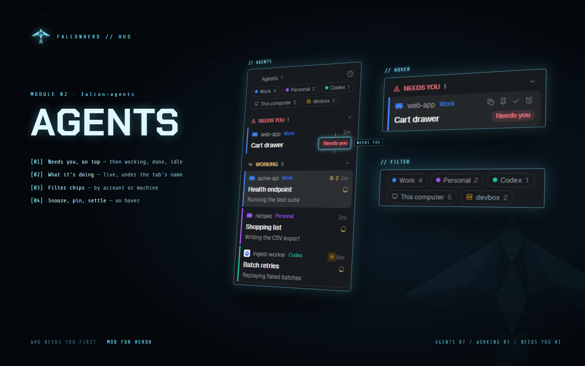

# Falcon Agents

An agents list for the Herdr desktop app that puts the agent that needs you first. Each agent is a
card with a 3px edge in its account's color, its account and space, its tab's name, and (if you
like) a line for what it's doing right now. Sections: Needs you, Done, Working, Idle, Snoozed,
Settled, Recently closed.



## Add it

Ask the agent in Herdr:

```text
Read ~/.config/herdr-app/AGENTS.md, then add this mod from https://github.com/HugoFMiranda/herdr-falconherd/tree/main/falcon-agents
```

It ships with: falcon-md (the Markdown window, for sub-agent pages).

## Use

- Click a card to show its pane. Hover: copy the session name, pin, settle (put the tab away),
  snooze (30 minutes … tomorrow 9:00, or until woken), wake.
- Filter chips by account and machine; sort by what needs you or by space.
- Recently closed reopens a conversation; after a restart, conversations whose terminals came back as
  shells are resumed.
- Running sub-agents fold under their card; its bot count opens them, a click shows one's task and
  latest output.
- Keys: `Ctrl+Space` then `A` (the next agent that needs you), `Z` (snooze an hour), `U` (reopen the
  last closed), `P` (pin).
- What's under the tab's name is set in the Accounts window → Titles (with the tab bar or status bar
  mods), or the profile's `titles.cards`: `tab` (nothing, as Herdr), `activity` (what the agent says
  it's doing; between replies Claude Code's name for the conversation), `haiku` (a Claude Haiku title
  between replies, asked after each reply, at most once a minute).

Part of [Falconherd](../falconherd/README.md), the layout that puts all of these together.
