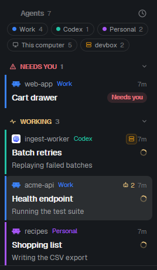

# Falcon Agents

An agents list for the Herdr desktop app that puts the agent that needs you first. Each agent is a
card with a 3px edge in its account's color, its account and space, its tab's name, and (if you
like) a line for what it's doing right now. Sections: Needs you, Done, Working, Idle, Snoozed,
Settled, Recently closed.

## What you see

- A block (in Falconherd: the lower half of the sidebar): an "Agents N" header (sort menu), filter
  chips, then sections with their counts (Snoozed, Settled and Recently closed folded at first).
- Cards: 3px account-colored edge; first line the account's glyph, space and account label, on the
  right machine badge, running sub-agents (bot icon + count), and the time in its state (or hover
  tools); second line the tab's name in 13.5px semibold and the state mark (spinner, red dot, check);
  an optional third line, 12px dim, for what's happening.
- On a narrow rail (under 160px): icons ringed in the space's color with a state badge.

## How it behaves

- working: spinner; blocked: Needs you section and red mark; done: check; idle: dimmed name.
- Snooze settles the tab until the time; a settled tab you look at goes back when you look elsewhere.
- A reopened conversation's tab closes again when you leave it, unless it's working or needs you.

- Click a card to show its pane. Hover: copy the session name, pin, settle (put the tab away),
  snooze (30 minutes … tomorrow 9:00, or until woken), wake.
- Filter chips by account and machine; sort by what needs you or by space.
- Recently closed reopens a conversation; after a restart, conversations whose terminals came back as
  shells are resumed.
- Running sub-agents fold under their card; its bot count opens them, a click shows one's task and
  latest output.
- Keys: `Ctrl+Space` then `A` (the next agent that needs you), `Z` (snooze an hour), `U` (reopen the
  last closed), `P` (pin).
- What's under the tab's name is set in the Accounts window → Titles (with the tab bar or status bar
  mods), or the profile's `titles.cards`: `tab` (nothing, as Herdr), `activity` (what the agent says
  it's doing; between replies Claude Code's name for the conversation), `haiku` (a Claude Haiku title
  between replies, asked after each reply, at most once a minute).

## Built from

- Block: `{ "mod": "falcon-agents" }`.
- Herdr: agents, terminals (an agent's `report.msg`), panes, spaces, machines, shared/setShared
  (`falcon-agents.*`, `space.colors`, `tabs.peeking`), setAgentOrder, run (pane.focus, tab.settle,
  tab.unsettle, tab.close, terminal.pin, tab.new / space.new to reopen), hc (get, send), exec, notify,
  nextCommand.
- session.js finds the conversation in a terminal (Claude Code's session file by process, Codex's
  rollout) and reads Claude's sub-agents; the claude-tabname helper writes Haiku titles.
- Mods shipped beside it (not placed in a layout): falcon-md (the Markdown window, for sub-agent pages).

## Watch out

- A machine that's away doesn't close its conversations; only hc's "not found" means a terminal
  ended.
- Crash-resume never types into a terminal an agent reports from, and each terminal only once.
- Haiku titles back off after failures (30 s up to 30 min).

## Done when

- A running Claude Code conversation shows a card in its account's color with a spinner.
- `Ctrl+Space` then `A` shows an agent that needs you, if any.
- Snooze moves it to Snoozed; its tab is put away.
