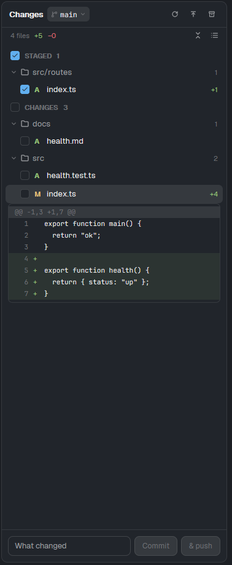

# Falcon Changes

A git changes panel for the Herdr desktop app: the focused pane's repo, its branch and how far it is
from upstream, Staged and Changes lists with a checkbox per file (as a list, or as a folder tree that
folds), diffs inline under each file, and a commit box.



*Staged and unstaged files in the folder tree, with their checkboxes, an inline diff, and the commit box.*

## Add it

Ask the agent in Herdr:

```text
Read ~/.config/herdr-app/AGENTS.md, then add this mod from <this repo's URL>/tree/main/falcon-changes
```

It ships with: Nothing else.

## Use

- Tick a file to stage it (untick to unstage); click it for its diff under it; discard asks first.
- The buttons on the files row: a list (each file's folder dimmed beside it) or a folder tree (chains
  of single folders merged, `src/routes`), as you last picked; in the tree, fold or unfold every folder.
- The branch button switches or creates a branch; fetch, pull, push, stash and unstash in the header.
- Commit, or Commit & push.

Part of [Falconherd](../falconherd/README.md), the layout that puts all of these together.
