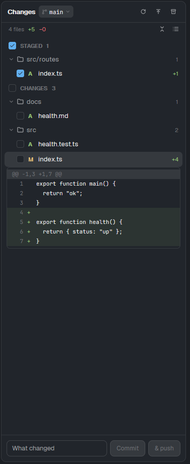

# Falcon Changes

A git changes panel for the Herdr desktop app: the focused pane's repo, its branch and how far it is
from upstream, Staged and Changes lists with a checkbox per file (as a list, or as a folder tree that
folds), diffs inline under each file, and a commit box.

## What you see

- A side-panel block: branch button with ↑/↓ counts and the remote tools; "Staged" and "Changes"
  sections (A, M, D, U letters, +/− counts) as a flat list or a folder tree (folder rows with a
  chevron and a file count; list / tree and fold all / unfold all on the files row); diffs with line numbers; the message box with Commit and
  & push at the bottom.

## How it behaves

- Refreshes when the repo's files change and every 10 s otherwise; the message stays while you stay
  in the same repo.

- Tick a file to stage it (untick to unstage); click it for its diff under it; discard asks first.
- The buttons on the files row: a list (each file's folder dimmed beside it) or a folder tree (chains
  of single folders merged, `src/routes`), as you last picked; in the tree, fold or unfold every folder.
- The branch button switches or creates a branch; fetch, pull, push, stash and unstash in the header.
- Commit, or Commit & push.

## Built from

- Block: `{ "mod": "falcon-changes" }` (in Falconherd, child `changes` of the `panel-body` stack).
- Herdr: panes, focused, exec (git with `--no-optional-locks` for reads, `--literal-pathspecs` for a
  file's commands), watchFolder, openOverlay (the branch popup), notify.
- Mods shipped beside it (not placed in a layout): Nothing else.

## Watch out

- Paths are literal (`app/[id]/page.tsx` is a path, not a pattern).
- The list / tree choice is kept in the mod's localStorage (`falcon-changes.view`).

## Done when

- In a git folder: the branch and changed files show; ticking a file stages it; Commit commits.
