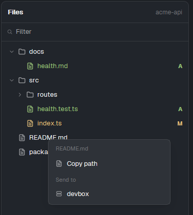

# Falcon Files

A files panel for the Herdr desktop app: the focused pane's folder as a tree with git colors (green
new, orange changed, red deleted) and a filter, a Markdown reader that follows the file, and copying
a file or folder to another connected machine.



*Git colors in the tree (added, modified), and a file's menu: copy its path, or send it to another machine.*

## Add it

Ask the agent in Herdr:

```text
Read ~/.config/herdr-app/AGENTS.md, then add this mod from <this repo's URL>/tree/main/falcon-files
```

It ships with: falcon-md (the Markdown window).

## Use

- Click a folder to open it, a file to read it (Markdown formatted, its links followed); pop it out
  into a Markdown window.
- A row's ⋯ or right-click: Copy path, Send to ▸ each connected machine (from another machine's space:
  Copy to this computer). The dialog shows the size, suggests the same project's folder there (or
  Downloads), takes `~` as that machine's home, and asks before replacing.

Part of [Falconherd](../falconherd/README.md), the layout that puts all of these together.
