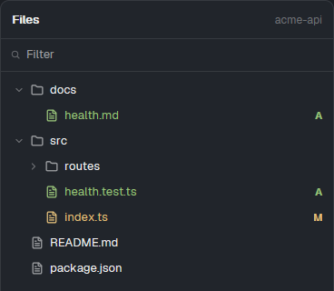

# Falcon Files

A files panel for the Herdr desktop app: the focused pane's folder as a tree with git colors (green
new, orange changed, red deleted) and a filter, a Markdown reader that follows the file, and copying
a file or folder to another connected machine.

## What you see

- A side-panel block (368px in Falconherd): header with the folder and tools, a filter field, the
  tree (folders first, git marks), or the open file (Markdown formatted, or the source).

## How it behaves

- The tree refreshes on file changes (a watch on the folder, not a home folder or a drive root) and
  every 10 s otherwise.
- Send to: `tar` streamed through `hc exec -i --on <machine>`; a failure on the sending side is
  reported, a file that changed while read counts as copied with a note.

- Click a folder to open it, a file to read it (Markdown formatted, its links followed); pop it out
  into a Markdown window.
- A row's ⋯ or right-click: Copy path, Send to ▸ each connected machine (from another machine's space:
  Copy to this computer). The dialog shows the size, suggests the same project's folder there (or
  Downloads), takes `~` as that machine's home, and asks before replacing.

## Built from

- Block: `{ "mod": "falcon-files" }` (in Falconherd, child `files` of the `panel-body` stack).
- Herdr: panes, focused, layout, exec (git, tar, du), hc (machine ls), readTextFile, watchFolder,
  openOverlay, notify, shared (`files.open`: a file asked for by another mod).
- Mods shipped beside it (not placed in a layout): falcon-md (the Markdown window).

## Watch out

- Paths reach the shell as arguments, quoted; Windows paths and Git's tar (`--force-local`) work.

## Done when

- The tree shows the focused pane's folder with git colors; the filter narrows it.
- Send to another machine copies a file there.
