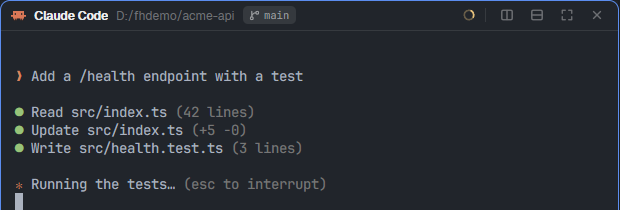

# Falcon Hood

A pane header for the Herdr desktop app, made for coding agents. It shows the conversation's
account (its glyph and label in its color), name, folder, branch, where it came from ("fork of x",
"side chat of y"), the machine, a session chip you can click to copy, the context meter, its
sub-agents and its state. On hover or focus a toolbar appears.



## Add it

Ask the agent in Herdr:

```text
Read ~/.config/herdr-app/AGENTS.md, then add this mod from <this repo's URL>/tree/main/falcon-hood
```

It ships with: falcon-status (its account menu, for Continue on…), falcon-roster (the Accounts window) and falcon-md (sub-agent pages).

## Use

- Toolbar: Send to main (ask a side chat for a brief and deliver it), Continue on another account,
  Side chat, Fork, split right / down, zoom, close.
- Keys: `Ctrl+Shift+S` (side chat), `Ctrl+Shift+D` (fork), `Ctrl+Shift+M` (send to main);
  `Ctrl+Space` then `B` (sub-agents), `W` (continue on another account).

Part of [Falconherd](../falconherd/README.md), the layout that puts all of these together.
