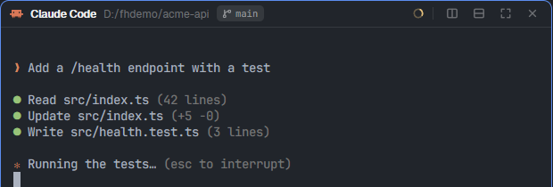

# Falcon Hood

A pane header for the Herdr desktop app, made for coding agents. It shows the conversation's
account (its glyph and label in its color), name, folder, branch, where it came from ("fork of x",
"side chat of y"), the machine, a session chip you can click to copy, the context meter, its
sub-agents and its state. On hover or focus a toolbar appears.

## What you see

- A 30px header on top of each pane: account glyph, label chip in the account's color, name,
  `~/folder`, branch, origin, machine badge, session chip, context meter, sub-agents count, state.
- The toolbar replaces the right side on hover or focus.

## How it behaves

- Fork and side chat start a copy of the conversation in a new tab (`--resume <id> --fork-session` for
  Claude, `fork` for Codex); Send to main asks the side chat for a brief and herdr-brief delivers it.
- The sub-agents popup lists the conversation's sub-agents; a click opens one's page.

- Toolbar: Send to main (ask a side chat for a brief and deliver it), Continue on another account,
  Side chat, Fork, split right / down, zoom, close.
- Keys: `Ctrl+Shift+S` (side chat), `Ctrl+Shift+D` (fork), `Ctrl+Shift+M` (send to main);
  `Ctrl+Space` then `B` (sub-agents), `W` (continue on another account).

## Built from

- Pane header: in the layout's tab block, `"pane": { "header": { "content": { "mod": "falcon-hood" },
  "height": 30, "position": "top", "reveal": "always" } }`.
- Herdr: panes, spaces, terminals, props (pane, terminal), run, hc, exec, notify, nextCommand,
  openOverlay (falcon-status's switch menu, its own sub-agents popup).
- session.js finds the conversation and its readings (context, sub-agents).
- Mods shipped beside it (not placed in a layout): falcon-status (its account menu, for Continue on…), falcon-roster (the Accounts window) and falcon-md (sub-agent pages).

## Watch out

- Commands act on the focused pane's header only (one copy per pane).
- A conversation with no messages yet can't be forked: it says so.

## Done when

- A Claude Code pane shows its account chip, folder and context.
- `Ctrl+Shift+D` opens a fork in a new tab.
