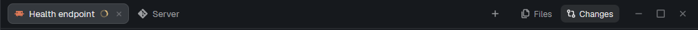

# Falcon Perch

A tab bar for the Herdr desktop app. Each tab wears its account's icon and color (or its
program's icon) and shows what its agent is doing: a spinner while it works, a red dot when it needs
you, a check when it's done. Settled tabs wait in "N away"; the side panels' buttons and the `+`
launcher sit on the right.

## What you see

- A 42px block across the work column: tabs (account glyph tinted in its color, name up to 180px,
  state mark, × on the shown one), "N away", `+`, one button per child of the layout's `panel-body`
  stack (Files, Changes, …), and window buttons where the system draws none.
- Popups: all tabs, the away ones, the tab menu (260px, items with their keys right-aligned).

## How it behaves

- Agent states on each tab as in the README.
- The + opens falcon-launch; panel buttons select the stack's child and show the `panel` node, or
  hide it when it's already showing.

- Click a tab to show it, drag to reorder, middle-click or × to close, the wheel steps through tabs.
- Right-click a tab: Rename, Regenerate title (Claude Haiku names it from its conversation), New tab,
  Close, each with its key.
- With Titles → Tab names: Claude Haiku (the Accounts window, or the profile's `titles.tabs`), a tab
  without a name you gave it is named from its conversation at 3 messages and again at 10, while it
  keeps that name.
- Each space remembers which side panel it showed.
- Keys: `Ctrl+Space` then `R` (regenerate the title), `L` (previous tab), `F` / `C` (Files / Changes
  panel; again hides it); `Alt+Shift+Left` / `Right` (move the tab).

## Built from

- Block: `{ "mod": "falcon-perch" }`. Optional layout ids: `panel` (a column) holding a `panel-body`
  stack, for the panel buttons.
- Herdr: spaces, panes, shared/setShared (`perch.*`, `tabs.peeking`), openOverlay, run (tab.select,
  tab.move, tab.rename, tab.new, tab.close, layout.select / show / hide), keys (to show each item's
  key), nextCommand, exec / helper (claude-tabname).
- Mods shipped beside it (not placed in a layout): falcon-launch (the `+` popover) and falcon-roster (the Accounts window, from the popover's Edit this menu).

## Watch out

- Haiku names are asked by one copy of the bar (a lease in `perch.owner`), back off after failures,
  and never replace a typed name on their own.

## Done when

- Tabs show with their account's color; a working agent's tab spins.
- Right-click a tab: the four items, with keys.
- `Ctrl+Space` then `L` returns to the previous tab.
