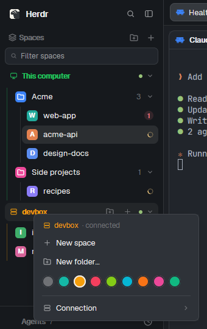

# Falcon Sidebar

The whole sidebar for the Herdr desktop app, in one mod with three parts: a top bar, the spaces
list and a footer. Your machines are the top level ("This computer" first, then each other machine in
its color); under each, colored folders and the spaces in them. A space row shows its color, its repo
and branch (`repo · branch ↑2 ↓1`), and how many of its agents are working or need you; worktrees sit
under their checkout.



*Two machines in their colors (this computer and devbox), the Acme and Side projects folders, a space whose agent needs you (the red 1) and ones at work, and devbox's right-click menu: new space, new folder, its color.*

## Add it

Ask the agent in Herdr:

```text
Read ~/.config/herdr-app/AGENTS.md, then add this mod from <this repo's URL>/tree/main/falcon-sidebar
```

It ships with: Nothing else: it uses Herdr's own picker, machine-add and worktree mods.

## Use

- Click a space to show it; drag it onto a folder, onto another space (it moves there), or onto
  "Drop here" to take it out of its folder.
- Right-click a space (colors, rename, worktrees, close), a folder (color, new space here, edit, move,
  delete) or a machine (new space, new folder, its color; another machine's connection page:
  reconnect, disconnect / connect, update hc, forget).
- Folders can collect spaces by where they work ("my-project, ~/code/client-*") and start new spaces
  in a folder. They're saved in `~/.config/falconherd-folders.json` on each machine, so every screen
  showing a machine's spaces shows the same folders.
- `Alt+Up` / `Alt+Down`: previous / next space as the list shows them.
- The focused pane's border takes the shown space's color (`settings.json` `colors.space_focus`).

Part of [Falconherd](../falconherd/README.md), the layout that puts all of these together.
