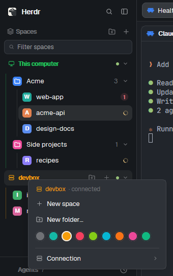

# Falcon Sidebar

The whole sidebar for the Herdr desktop app, in one mod with three parts: a top bar, the spaces
list and a footer. Your machines are the top level ("This computer" first, then each other machine in
its color); under each, colored folders and the spaces in them. A space row shows its color, its repo
and branch (`repo · branch ↑2 ↓1`), and how many of its agents are working or need you; worktrees sit
under their checkout.

## What you see

- A sidebar column (268px in Falconherd, folding to a 44px rail with its fold button) of three
  blocks, all `falcon-sidebar` with `props.part`: `top` (46px, drags the window: Herdr's logo and name,
  search, fold), `spaces` (the list, takes the height), `foot` (41px: Settings with a dot when an
  update is ready, Add machine; 69px stacked on the rail).
- The list: a "Spaces" header (new folder, new space), a filter field, then per machine a header
  (monitor or server icon, name in the machine's color, state word when not connected, hover tools:
  new folder, new space; folded: "3 spaces · 2 working · 1 needs you") and a faint 1px line in the
  machine's color beside its folders and spaces. Folders: an 18px colored tile, name, count, chevron;
  their spaces hang from a guide line. Space rows: 30px, an 18px avatar (first letter, the space's
  color), the name, the repo line dimmed, a spinner while its agents work, a red count of those that
  need you. A machine with no spaces says "No spaces".

## How it behaves

- Agent states: working (spinner on the row), blocked (red count; a folded folder shows a red dot).
- Drag and drop, menus, folders and keys as in the README. The space menu's colors are
  `shared("space.colors")`; a space without one gets the least-used color.
- Machine actions (reconnect, connect, disconnect, update, forget) are run by the list, not the menu
  (a popup's work ends when it closes); the machine's header says what's under way.

- Click a space to show it; drag it onto a folder, onto another space (it moves there), or onto
  "Drop here" to take it out of its folder.
- Right-click a space (colors, rename, worktrees, close), a folder (color, new space here, edit, move,
  delete) or a machine (new space, new folder, its color; another machine's connection page:
  reconnect, disconnect / connect, update hc, forget).
- Folders can collect spaces by where they work ("my-project, ~/code/client-*") and start new spaces
  in a folder. They're saved in `~/.config/falconherd-folders.json` on each machine, so every screen
  showing a machine's spaces shows the same folders.
- `Alt+Up` / `Alt+Down`: previous / next space as the list shows them.
- The focused pane's border takes the shown space's color (`settings.json` `colors.space_focus`).

## Built from

- Blocks: `{ "mod": "falcon-sidebar", "props": { "part": "top" | "spaces" | "foot" } }`. The footer
  resizes its own block (`sidebar-footer`) between 41 and 69px; the fold button resizes the
  `sidebar` node. Ids it looks for: `sidebar`, `sidebar-footer`.
- Herdr: spaces, panes, agents, machines, layout, shared/setShared, openOverlay, run (space.select,
  space.move, space.new, space.rename, space.close, layout.resize, mod.open), exec (git status
  --porcelain=v2), hc (machine ls/login/add/rm/update), readTextFile / writeTextFile (the folders file),
  watchFolder (local repos), nextCommand.
- Files: main.js (list), chrome.js (top bar, footer), store.js (folders, files), menus.js (popups),
  machines.js (machine actions), core.js (shared helpers: folder rules, colors, git line, worktrees).
- Mods shipped beside it (not placed in a layout): Nothing else: it uses Herdr's own picker, machine-add and worktree mods.

## Watch out

- Popups (space, folder, machine menus, the folder dialog) only change shared state; the list
  writes the folders file and runs machine actions.
- A machine's folders file is written only after it was read (an unreadable one is never written over).
- Remote machines are assumed Unix.

## Done when

- Machines and spaces show; New folder makes a folder; dragging a space onto it puts it there and
  the folders file changes.
- Right-clicking a machine shows New space, New folder and its colors.
- `Alt+Down` shows the next space.
