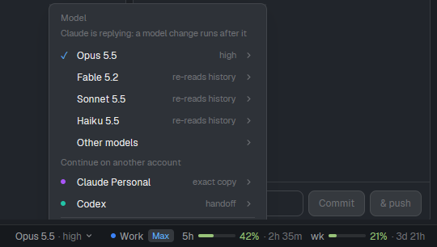

# Falcon Status

A status bar for the Herdr desktop app, about the focused agent: its model and effort (both menus),
its account with its plan, and its 5-hour and weekly usage with when they reset; the machine and the
agents count on the left.

## What you see

- A 28px block at the bottom: machine, agents count (and how many need you); on the right model ·
  effort, account label and plan chip, 5h and wk bars with percentages and reset times.

## How it behaves

- Readings refresh every few seconds for the focused agent; the bars change color as they near the limit.

- Pick a model or effort from their menus: the command is pasted into the conversation for you to
  send.
- The account menu: switch the conversation to another account, or open the Accounts window.
- `Ctrl+Shift+G`: the usage breakdown.
- Usage comes from the claude-usage helper (Node; see the repo's helpers).

## Built from

- Block: `{ "mod": "falcon-status" }`.
- Herdr: focused, panes, agents, exec / helper (claude-usage), openOverlay (its menus, falcon-accounts),
  keys, nextCommand.
- Mods shipped beside it (not placed in a layout): falcon-accounts (the Accounts window: accounts, the + menu's entries, Titles).

## Watch out

- Without the claude-usage helper there are no bars; everything else works.

## Done when

- With a Claude Code pane focused: model, effort, account and usage show.
