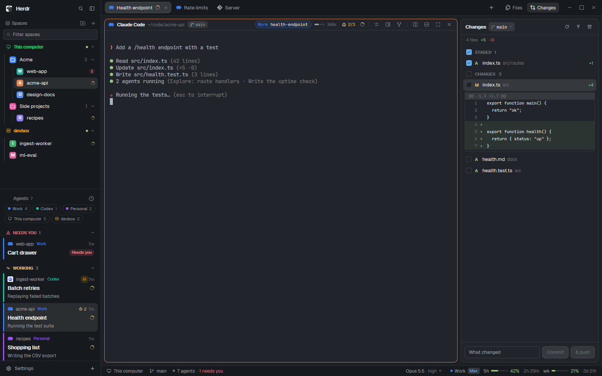

# Falconherd

A full Herdr layout for working with coding agents: your machines, folders and spaces in the sidebar,
an agents list that tells you who needs you (and, if you like, what each one is doing right now), tabs
and pane headers that wear each account's color, files and git changes beside the terminal (with copy
to another machine), and a status bar with the agent's model, effort and usage.

## Add it

Ask the agent in Herdr: "Read ~/.config/herdr-app/AGENTS.md, then add this layout from https://github.com/HugoFMiranda/herdr-falconherd/tree/main/falconherd". It copies `layouts/` and `mods/`, merges `keys.json`, checks each mod and
switches to the layout (ctrl-shift-l switches back). Each part is also a mod of its own: see the
repo's README.

Or by hand: copy `layouts/falconherd.json` and the `mods/falcon-*` folders into your Herdr home
(`~/.config/herdr-app`), merge `keys.json` into yours, then pick Falconherd in Settings → Look.

## Helpers (optional)

The repo's `helpers/install.sh` links a few small programs into `~/.local/bin`: tab names written by Claude
Haiku, readable pages for sub-agents and conversations, side chat briefs, and account usage in the
status bar. Everything else works without them.

## Keys

The layout brings its own keys (merged into yours on install). The ones you'll use most: `Ctrl+Space`
then `A` (the next agent that needs you), `S` / `Z` (put the tab away / snooze it), `U` (reopen the
last closed conversation), `L` (previous tab), `F` / `C` (Files / Changes panel), `R` (regenerate
the tab's title); `Alt+Up` / `Alt+Down` (spaces); `Shift+PageUp` / `PageDown` (scroll history).
`RECIPE.md` lists them all.

## Titles

Tabs keep Herdr's names and the agents list shows them, as in Herdr, until you pick otherwise in the
Accounts window → Titles: tab names written by Claude Haiku from the conversation, and agent cards
with a line for what's happening (what the agent says it's doing, or a Haiku summary between replies).
Right-click a tab → Regenerate title asks for one at any time. Haiku runs on the conversation's own
account.

## Accounts

Your accounts (which config folder each Claude Code or Codex account uses, its color and icon) and
the + menu's entries are set in the Accounts window (Accounts, + menu and Titles tabs): the status
bar's account menu → Accounts, or the + menu's Edit this menu. They save to `machines/<this computer>.json` in your Herdr home.

`RECIPE.md` describes the whole layout, for building it again from scratch.

macOS and Linux first: on Windows the layout works, and the helpers need setting up by hand.
